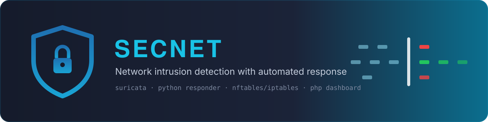
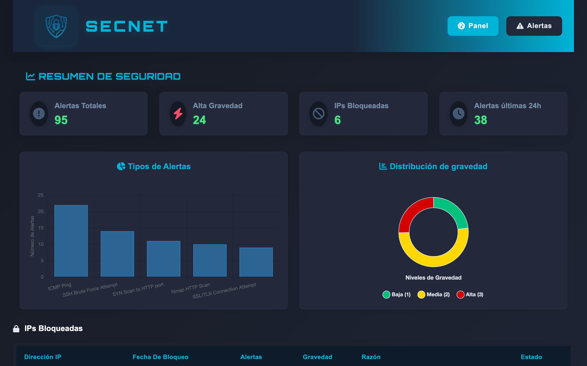
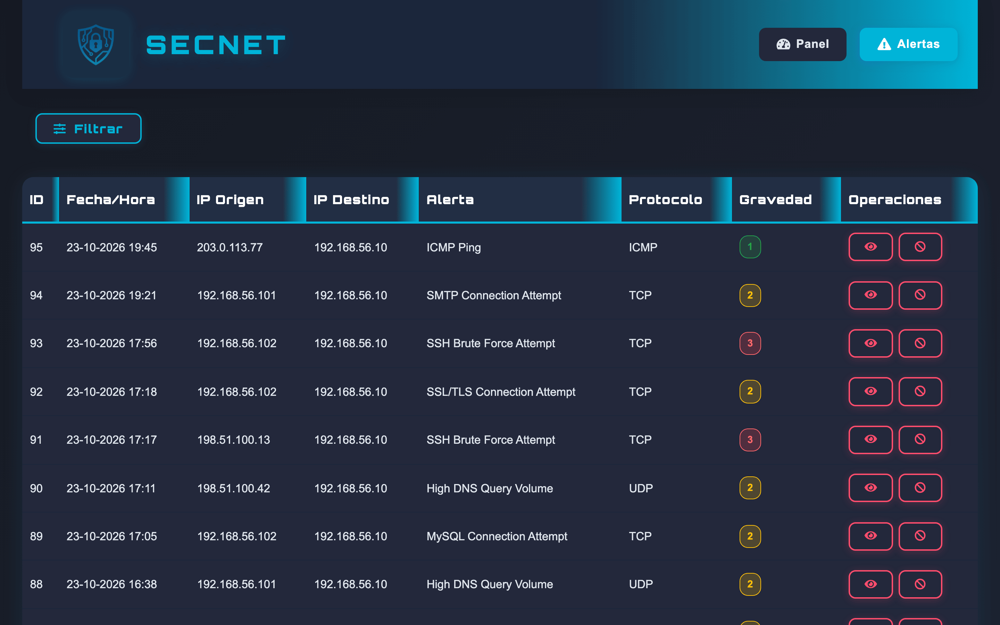
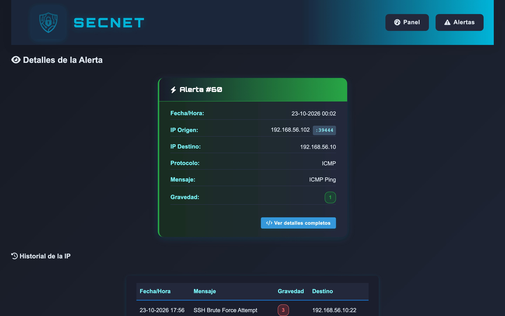
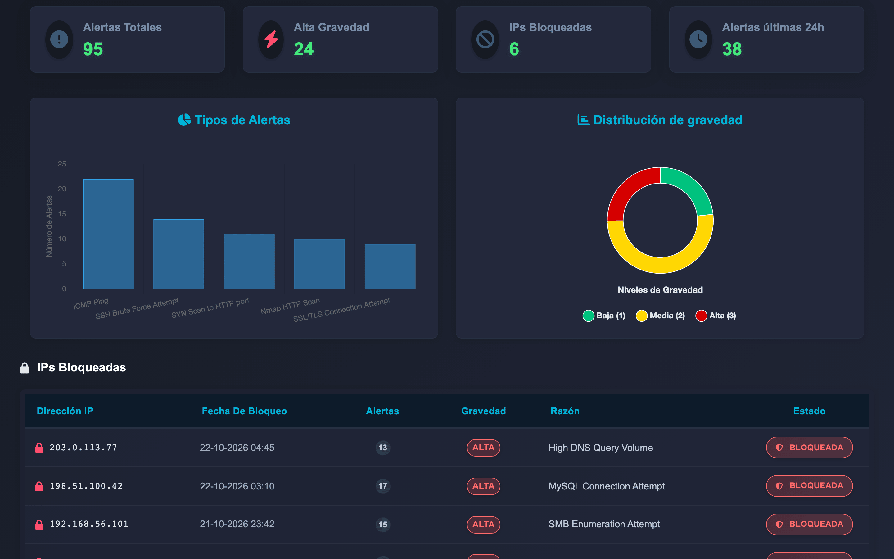
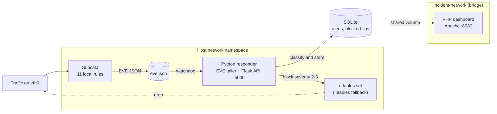

<p align="center">
  
</p>

<p align="center">
  
  
  
  
  
  
  
</p>

<p align="center"><b>Detects hostile traffic with Suricata, blocks the source automatically in the host firewall and keeps a forensic trail you can browse from a dashboard.</b></p>

SecNet is my final degree project for the ASIR program (Network Systems Administration), graded 10/10. Three containers cooperate: Suricata inspects the traffic on the host interface, a Python responder tails Suricata's EVE JSON log, classifies each alert, stores it in SQLite and blocks offending IPs with nftables (falling back to iptables), and a PHP dashboard reads the same database to show alerts, trends and blocked IPs.



## Screenshots

<table>
  <tr>
    <td width="50%"><br><sub><b>Alerts</b>: every Suricata alert with source, destination, protocol and severity.</sub></td>
    <td width="50%"><br><sub><b>Forensic detail</b>: one alert with ports, the raw EVE record and the history of the source IP.</sub></td>
  </tr>
  <tr>
    <td width="50%"><br><sub><b>Blocked IPs</b>: when and why each address was blocked, and how many alerts it produced.</sub></td>
    <td width="50%">Screenshots come from the real web container running against a demo database: alerts generated from the project's own 11 rules, with source IPs from a lab range (192.168.56.0/24) and the RFC 5737 documentation ranges. The interface is in Spanish; 1440x900.</td>
  </tr>
</table>

## Architecture



- **Suricata** and the **responder** share the host network namespace: Suricata needs the real interface, and the responder needs `NET_ADMIN` to change the host firewall.
- The responder watches `eve.json` with `watchdog`, parses each alert, stores it and decides whether to block.
- The **dashboard** runs on its own bridge network and reads the SQLite file through a shared volume, so it never needs write access to the firewall.

## Alert classification

The severity is Suricata's rule `priority`, mapped to three levels:

| Severity | Meaning in the responder | Response |
|---|---|---|
| **3** High | `Amenaza de alta gravedad` (high-severity threat) | Source IP blocked |
| **2** Medium | `Actividad sospechosa` (suspicious activity) | Source IP blocked |
| **1** Low | `Actividad de red normal` (normal network activity) | Logged |

Independently of the level, SSH brute force, port scans (including the SYN scan rule) and ICMP ping sweeps always lead to a block. Localhost and self-traffic are never blocked.

## Detection rules

The 11 rules in [`suricata/rules/local.rules`](suricata/rules/local.rules):

| Rule | Port | Priority |
|---|---|---|
| SSH Brute Force Attempt | 22/tcp | 3 |
| SMB Enumeration Attempt | 445/tcp | 3 |
| Telnet Connection Attempt | 23/tcp | 3 |
| Nmap HTTP Scan | 80/tcp | 2 |
| SYN Scan to HTTP port | 80/tcp | 2 |
| High DNS Query Volume | 53/udp | 2 |
| SSL/TLS Connection Attempt | TLS | 2 |
| MS-SQL Connection Attempt | 1433/tcp | 2 |
| MySQL Connection Attempt | 3306/tcp | 2 |
| SMTP Connection Attempt | 25/tcp | 2 |
| ICMP Ping | ICMP | 1 |

## Key engineering decisions

- **IDS and response decoupled through a log.** Suricata only writes EVE JSON; the responder consumes it. Either side can be restarted or replaced without touching the other.
- **nftables first, iptables as a fallback.** Blocks are added to an nftables set (one rule, many addresses) and the ruleset is saved so it survives restarts; on hosts without nftables the responder inserts iptables `DROP` rules instead.
- **Idempotent blocking.** Before blocking, the responder checks both the firewall and the database, so repeated alerts from the same source do not pile up duplicate rules.
- **One SQLite file as the contract.** The responder writes, the dashboard reads; WAL mode keeps reads from blocking the writer.
- **Least privilege where possible.** Only the responder is privileged; the dashboard runs unprivileged on a separate network.

## Quickstart

Requirements: a Linux host (the project was built and tested on Kali Linux) with Docker and Docker Compose, and a network interface named `eth0` or the name changed in `suricata/suricata.yaml` and `docker-compose.yml`.

```bash
git clone https://github.com/diegoperezg7/TFG-SecNet.git
cd TFG-SecNet
docker compose up -d --build
```

- Dashboard: `http://localhost:8080`
- Responder API: `http://localhost:5000/alerts`

To check the pipeline without generating real attack traffic, `test_alert.py` appends a synthetic alert to the EVE log.

## Repository structure

```
TFG-SecNet/
├── docker-compose.yml
├── suricata/
│   ├── Dockerfile
│   ├── suricata.yaml          # af-packet on eth0, EVE JSON output
│   └── rules/local.rules      # the 11 detection rules
├── python-responder/
│   ├── Dockerfile
│   ├── responder.py           # EVE tailer, classifier, blocker, Flask API
│   ├── init-nftables.sh       # nftables table and set bootstrap
│   └── startup.sh
├── web-interface/
│   ├── Dockerfile             # php:7.4-apache
│   ├── index.php              # dashboard
│   ├── alerts.php             # alert list and filters
│   ├── alert-details.php      # forensic view
│   ├── api/                   # JSON endpoints for the dashboard
│   └── includes/              # config and database access
├── database/init.sql          # schema
├── docs/                      # banner and screenshots
└── test_alert.py              # synthetic EVE alert
```

## Known limitations

- Built as an academic project for a lab network; it has not been hardened for production.
- Blocking or unblocking from the dashboard updates the shared database; the firewall itself is changed by the responder when it processes alerts.
- Detection relies on the 11 local rules above; the default Suricata ruleset is not bundled.

## License

Copyright (c) 2024-2026 Diego Pérez. All rights reserved.

Published for portfolio and evaluation purposes only. You may read the code to evaluate the author's work; copying, modifying, distributing or using it requires written permission. See [LICENSE](LICENSE).
